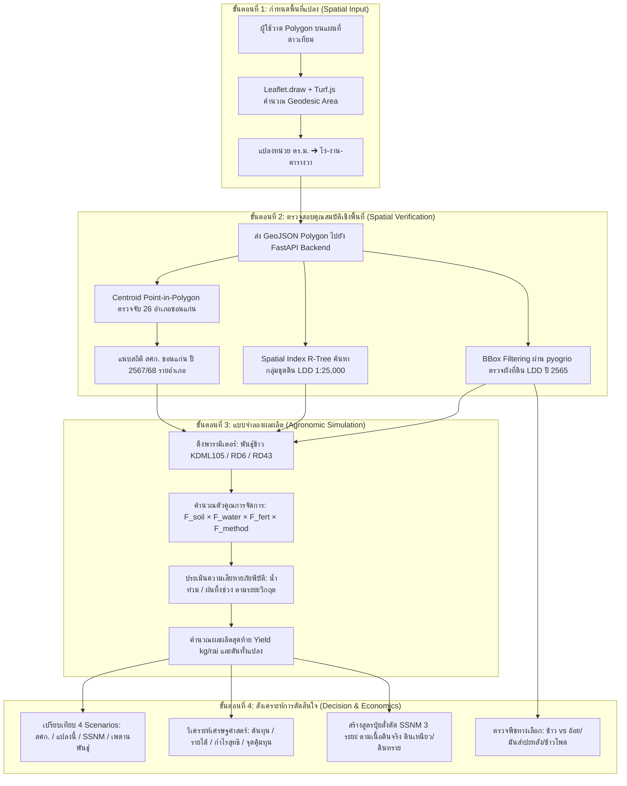

# 🌾 โครงการจำลองพื้นที่เพาะปลูกเสมือนจริงเชิงแผนที่เพื่อการวิเคราะห์และวางแผนผลผลิตข้าว
## กรณีศึกษา: จังหวัดขอนแก่น (Khon Kaen 26 Districts Case Study)
**Interactive Map-Based Agro-Spatial Sandbox Simulator for Rice Yield Analytics and Crop Decision Support**

> **รายวิชา:** CP353761 สัมมนาทางวิทยาการคอมพิวเตอร์ (Computer Science Seminar)  
> **หน่วยงาน:** สาขาวิชาวิทยาการคอมพิวเตอร์ วิทยาลัยการคอมพิวเตอร์ มหาวิทยาลัยขอนแก่น (KKU)  
> **ผู้จัดทำ:** นายปฏิภาณ ปานทะเล (673380411-3), นายอาณัฐ อารีย์ (673380432-5)  
> **อาจารย์ที่ปรึกษา:** อ. ดร.พบพร ด่านวิรุทัย (Dr. Pobporn Danvirutai)

---

## 📌 สารบัญ (Table of Contents)
1. [ที่มา ความสำคัญ และปัญหาที่แท้จริง (Problem Statement)](#1-ที่มา-ความสำคัญ-และปัญหาที่แท้จริง-problem-statement)
2. [ทำไมต้องเจาะจง "จังหวัดขอนแก่น"? (Why Khon Kaen?)](#2-ทำไมต้องเจาะจง-จังหวัดขอนแก่น-why-khon-kaen)
3. [วัตถุประสงค์ของโครงงาน (Project Objectives)](#3-วัตถุประสงค์ของโครงงาน-project-objectives)
4. [กรอบกระบวนการทำงานและสถาปัตยกรรมระบบ (Methodology & Architecture)](#4-กรอบกระบวนการทำงานและสถาปัตยกรรมระบบ-methodology--architecture)
5. [คลังข้อมูลและการอุดช่องโหว่ด้านข้อมูล (Data Integration & Gap Mitigation)](#5-คลังข้อมูลและการอุดช่องโหว่ด้านข้อมูล-data-integration--gap-mitigation)
6. [แบบจำลองผลผลิตและตรรกะการประมวลผลเชิงลึก (Mathematical & Agronomic Model)](#6-แบบจำลองผลผลิตและตรรกะการประมวลผลเชิงลึก-mathematical--agronomic-model)
7. [การวิเคราะห์พืชทางเลือกและผังการใช้ประโยชน์ที่ดิน (Alternative Crops & Land Use)](#7-การวิเคราะห์พืชทางเลือกและผังการใช้ประโยชน์ที่ดิน-alternative-crops--land-use)
8. [จุดเด่นและข้อเปรียบเทียบกับระบบที่มีอยู่เดิม (Competitive Advantage & Value)](#8-จุดเด่นและข้อเปรียบเทียบกับระบบที่มีอยู่เดิม-competitive-advantage--value)
9. [โครงสร้างโค้ดและวิธีติดตั้งรันระบบ (Repository Structure & Setup)](#9-โครงสร้างโค้ดและวิธีติดตั้งรันระบบ-repository-structure--setup)
10. [เอกสารและงานวิจัยอ้างอิง (References)](#10-เอกสารและงานวิจัยอ้างอิง-references)

---

## 1. ที่มา ความสำคัญ และปัญหาที่แท้จริง (Problem Statement)

### 1.1 ความไม่แน่นอน 3 ด้านของการทำนาในภาคตะวันออกเฉียงเหนือ
ข้าวเป็นพืชเศรษฐกิจและความมั่นคงทางอาหารหลักของประเทศไทย โดยเฉพาะในภาคตะวันออกเฉียงเหนือ (อีสาน) ซึ่งเป็นแหล่งปลูกข้าวหอมมะลิ (KDML105) และข้าวเหนียว (กข6) ที่ใหญ่ที่สุด แต่เกษตรกรในพื้นที่ต้องเผชิญกับ **"สามเหลี่ยมความเปราะบาง (Vulnerability Triangle)"**:
1. **ข้อจำกัดทางกายภาพของดิน (Soil Constraints):** พื้นที่ส่วนใหญ่เป็นดินทราย (Sand / Sandy Loam) เช่น ชุดดินน้ำพอง (Ng), ชุดดินโคราช (Kt), และชุดดินร้อยเอ็ด (Re) มีความสามารถในการอุ้มน้ำต่ำ ความอุดมสมบูรณ์ต่ำ ดินเป็นกรด และขาดธาตุอาหารหลักโดยเฉพาะโพแทสเซียม ($K$)
2. **การพึ่งพาน้ำฝนสูง (Rainfed Vulnerability):** พื้นที่นาข้าวในภาคอีสานกว่า 90% อยู่นอกเขตชลประทาน หากเกิดภาวะฝนทิ้งช่วง (Dry Spell) ในช่วงตั้งท้อง-ออกดอก ข้าวจะเกิดอาการเมล็ดลีบอย่างรุนแรง และหากเกิดน้ำท่วมขังฉับพลันในฤดูมรสุม ข้าวจะเสียหายทั้งแปลง
3. **กับดักต้นทุนและผลผลิตต่ำ (Yield-Cost Trap):** ต้นทุนการผลิตเฉลี่ยอยู่ที่ 3,900–4,000 บาท/ไร่ แต่ผลผลิตเฉลี่ยจริงได้เพียง 320–340 กก./ไร่ ซึ่งต่ำกว่าศักยภาพทางพันธุกรรม (Genetic Ceiling) ที่ทำได้ถึง 550–650 กก./ไร่ เกิดเป็น **ช่องว่างผลผลิต (Yield Gap)** กว้างถึง 40–50%

### 1.2 ปัญหาและช่องว่างของเครื่องมือในปัจจุบัน (Research Gap)
จากการศึกษาระบบและงานวิจัยที่เกี่ยวข้อง พบว่าเครื่องมือที่มีอยู่ในปัจจุบันมีข้อจำกัดที่ใช้งานจริงในระดับแปลงได้ยาก:
* **กลุ่มแอปพลิเคชันพยากรณ์ระดับมหภาค (Macro/Regional Tools):** แอปทั่วไปส่วนใหญ่แสดงข้อมูลสภาพอากาศหรือผลผลิตเฉลี่ยระดับจังหวัด/ภาค ซึ่ง **"ไม่รู้บริบทของแปลงจริง (Context-blind)"** ไม่ทราบว่าแปลงที่เกษตรกรยืนอยู่เป็นดินทรายหรือดินเหนียว ปลูกข้าวพันธุ์อะไร มีสระน้ำสำรองหรือไม่ และใส่ปุ๋ยอย่างไร
* **กลุ่มแบบจำลองทางสรีรวิทยาชั้นสูง (Complex Process-Based Models เช่น DSSAT, ORYZA):** แม้จะมีความแม่นยำทางทฤษฎีสูง แต่ต้องการพารามิเตอร์ระดับพันธุกรรม (Genetic Coefficients) ลึกซึ้ง ข้อมูลดินรายชั้น (Soil Profile) หลายสิบตัวแปร และข้อมูลสภาพอากาศรายวันระดับสถานีตรวจวัด ซึ่งเป็นภาระเกินไปสำหรับผู้ใช้งานทั่วไป ไม่สามารถนำมาประมวลผลแบบโต้ตอบทันทีบนเว็บ (Interactive Sub-second Simulation) ได้
* **กลุ่มการใช้ภาพถ่ายดาวเทียม Optical (Sentinel-2 / Landsat NDVI):** ฤดูทำนาข้าวนาปีของไทย (มิถุนายน – พฤศจิกายน) ตรงกับฤดูมรสุมตะวันตกเฉียงใต้ ส่งผลให้ท้องฟ้ามีเมฆปกคลุมหนาแน่น (Cloud Cover > 80%) ภาพถ่ายดาวเทียมแบบแสงไม่สามารถมองทะลุเมฆได้ต่อเนื่อง การหวังพึ่งค่า NDVI สดรายแปลงจึงมักเกิดข้อมูลขาดหาย (Data Gaps) หรือคำนวณคลาดเคลื่อน

---

## 2. ทำไมต้องเจาะจง "จังหวัดขอนแก่น"? (Why Khon Kaen?)

โครงงานนี้ไม่ได้เลือกจังหวัดขอนแก่นเพียงเพราะเป็นที่ตั้งของมหาวิทยาลัย แต่เลือกเป็น **"พื้นที่ห้องทดลองกรณีศึกษาต้นแบบที่มีข้อมูลสมบูรณ์ที่สุด (High-Resolution Pilot Testbed)"** ด้วยเหตุผลเชิงประจักษ์ 4 ด้าน:

| เหตุผลเชิงยุทธศาสตร์ | ข้อมูลสนับสนุนเชิงประจักษ์ในจังหวัดขอนแก่น |
|---|---|
| **1. ตัวแทนที่สมบูรณ์ของเกษตรกรรมน้ำฝนอีสาน** | ขอนแก่นมีพื้นที่ปลูกข้าวนาปี **2,310,469 ไร่** โดยเป็น **นาน้ำฝนถึง 90.72%** (ผลผลิตเฉลี่ย 325 กก./ไร่) และอยู่ในเขตชลประทานเพียง 9.28% (ผลผลิต 437 กก./ไร่) ทำให้เห็นความแตกต่างของปัจจัยน้ำอย่างเด่นชัดที่สุด |
| **2. ศูนย์กลางความหลากหลายของพันธุ์ข้าว** | มีสัดส่วนพันธุ์ข้าวหลักสะท้อนวิถีอีสานชัดเจน: **ข้าวเหนียวกข6 (70.11%)** สำหรับบริโภคในครัวเรือน และ **ข้าวหอมมะลิ KDML105 (28.69%)** สำหรับจำหน่ายเชิงพาณิชย์ |
| **3. ความสมบูรณ์ของฐานข้อมูลเชิงพื้นที่ (GIS Data Maturity)** | มีชั้นข้อมูลแผนที่กลุ่มชุดดินความละเอียด 1:25,000 ของกรมพัฒนาที่ดิน (LDD), แผนที่ผังการใช้ที่ดิน (Land Use) อัปเดตปี **2565**, และสถิติผลผลิตข้าว-ต้นทุนการผลิตจริงรายอำเภอครบทั้ง **26 อำเภอ** จากสำนักงานเศรษฐกิจการเกษตรที่ 4 (สศท.4 ขอนแก่น) |
| **4. ความท้าทายจากภัยพิบัติซ้ำซาก** | พื้นที่ลุ่มน้ำพอง-ลำชีประสบอุทกภัยซ้ำซาก (ปี 2568 นาข้าวเสียหาย 50,488 ไร่ใน 16 อำเภอ) ขณะที่พื้นที่ดอนประสบภัยแล้งฝนทิ้งช่วง ทำให้ระบบสามารถทดสอบโมเดลภัยพิบัติได้อย่างมีนัยสำคัญ |

---

## 3. วัตถุประสงค์ของโครงงาน (Project Objectives)

โครงงานนี้ถูกออกแบบขึ้นเพื่อแก้ปัญหาความไม่ต่อเนื่องของขั้นตอนการวิเคราะห์ โดยเชื่อมโยง 4 วัตถุประสงค์หลักเข้าด้วยกันอย่างเป็นระบบ:

1. **การจำลองเชิงพื้นที่ระดับแปลงจริง (Parcel-level Spatial Sandbox):**  
   พัฒนาระบบเว็บแอปพลิเคชันที่ให้ผู้ใช้วาดรูปหลายเหลี่ยม (Polygon) แปลงนาบนภาพถ่ายดาวเทียมความละเอียดสูง และคำนวณขนาดพื้นที่ตามความโค้งของโลก (**Geodesic Area ด้วย Turf.js**) แปลงหน่วยอัตโนมัติเป็น ตารางเมตร และหน่วยวัดไทย (ไร่-งาน-ตารางวา)
2. **การบูรณาการข้อมูลเชิงพื้นที่หลายชั้นข้อมูล (Multi-Layer Spatial Data Integration):**  
   ออกแบบ Data Pipeline ตรวจสอบพิกัดแปลงกับชั้นข้อมูลทางภูมิศาสตร์จริงในจังหวัดขอนแก่นแบบทันที (Real-time Spatial Query):
   - ระบุอำเภอจาก 26 อำเภอ
   - ดึงกลุ่มชุดดิน (Soil Group จาก 62 กลุ่ม) และสมบัติของดินบน-ดินล่างจากกรมพัฒนาที่ดิน (LDD)
   - ตรวจสอบความถูกต้องของประเภทการใช้ที่ดิน (Land Use Verification) จากฐานข้อมูล LDD ปี 2565 เพื่อเตือนหากแปลงไม่ได้อยู่ในเขตพื้นที่นาข้าว
3. **การสร้างแบบจำลองผลผลิตแบบอธิบายได้ (Explainable Multi-Factor & Threshold Yield Model):**  
   สร้างแบบจำลองคาดการณ์ผลผลิตข้าวที่ผสานเพดานพันธุกรรมข้าวไทย ($Y_{genetic}$) เข้ากับตัวคูณการจัดการแปลงจริง (ดิน, น้ำ, ปุ๋ย, วิธีปลูก) ร่วมกับ **แบบจำลองเกณฑ์ภัยพิบัติตามระยะการเจริญเติบโต (Stage-based Disaster Threshold Model)** ทั้งน้ำท่วมและภัยแล้ง
4. **ระบบสนับสนุนการตัดสินใจและเปรียบเทียบฉากทัศน์ (Agro-Decision Support & Scenario Analysis):**  
   คำนวณและเปรียบเทียบผลลัพธ์พร้อมกัน 4 ฉากทัศน์ (สถิติจริง สศก. vs การจัดการปัจจุบัน vs แผนปุ๋ยสั่งตัด SSNM vs เพดานพันธุกรรม), วิเคราะห์ความเป็นไปได้ (Feasibility & Yield Gap), คำนวณต้นทุน-กำไรสุทธิ-จุดคุ้มทุน (ROI), และแนะนำแผนการใส่ปุ๋ยสั่งตัด 3 ระยะตรงตามชนิดเนื้อดินจริง

---

## 4. กรอบกระบวนการทำงานและสถาปัตยกรรมระบบ (Methodology & Architecture)

การทำงานของระบบแบ่งออกเป็น 4 ขั้นตอนที่เชื่อมต่อกันอย่างต่อเนื่อง (Seamless Operational Flow):



---

## 5. คลังข้อมูลและการอุดช่องโหว่ด้านข้อมูล (Data Integration & Gap Mitigation)

เพื่อให้ระบบตอบคำถามกรรมการได้ว่า **"ข้อมูลที่มีครบจริงหรือ และอุดช่องโหว่อย่างไร?"** โครงสร้างข้อมูลจึงถูกจัดเก็บและจัดการดังนี้:

### 5.1 รายการแหล่งข้อมูลจริงที่ผสานในระบบ (Integrated Data Layers)

| ลำดับชั้นข้อมูล (Layer) | แหล่งที่มาของข้อมูล | รูปแบบข้อมูลและมาตราส่วน | บทบาทและการนำไปใช้ในระบบ |
|---|---|---|---|
| **1. ฐานข้อมูลกลุ่มชุดดิน (Soil Series & Groups)** | กรมพัฒนาที่ดิน (LDD) | Shapefile (`soilgroup_kkn.shp`) มาตราส่วน 1:25,000 | ระบุเลขกลุ่มชุดดิน, เนื้อดินบน/ล่าง, กรด-ด่าง ($pH$), ความอุดมสมบูรณ์ แปลงเป็นค่าความเหมาะสม $S1, S2, S3, N$ ($F_{soil}$) |
| **2. ผังการใช้ที่ดิน (Land Use LDD 2565)** | สำนักสำรวจและวางแผนการใช้ที่ดิน กรมพัฒนาที่ดิน | Shapefile (`LU_KKN_2565.shp`) ความละเอียดแปลงที่ดิน ปี 2565 | ตรวจสอบว่าแปลงที่วาดอยู่ในโซนนาข้าว ($A101$) หรือเป็นพืชดอน ($A201, A202$) หากวาดบนชุมชน ($U$) ระบบจะขึ้นคำเตือนทันที |
| **3. สถิติการเกษตรระดับอำเภอ (OAE Benchmark)** | สำนักงานเศรษฐกิจการเกษตรที่ 4 ขอนแก่น (สศท.4) | ฐานข้อมูลสถิติปีการผลิต **2567/68** (26 อำเภอ) | เป็นค่าฐานเปรียบเทียบผลผลิตจริง (Ground Truth Benchmark) และคำนวณส่วนต่าง Yield Gap |
| **4. พารามิเตอร์สรีรวิทยาและราคาผลผลิต** | กรมการข้าว, สมาคมโรงสีข้าว, ตลาดกลาง ธ.ก.ส. ขอนแก่น | JSON โครงสร้างพันธุ์ข้าวและราคาซื้อขายข้าวเปลือก | เพดานผลผลิต ($Y_{genetic}$), อายุเก็บเกี่ยว, ความไวต่อช่วงแสง, ราคาข้าวเปลือกชื้น 15%, และต้นทุนต่อไร่ |
| **5. สูตรปุ๋ยสั่งตัดเฉพาะพื้นที่ (SSNM Recommendations)** | กรมวิชาการเกษตร และโครงการปุ๋ยสั่งตัด มหาวิทยาลัยเกษตรศาสตร์ | ฐานข้อมูลตารางคำแนะนำธาตุอาหารตามชุดดิน | สูตรปุ๋ย $N-P-K$ และอัตราการใส่ 3 ระยะ แบ่งตามกลุ่มเนื้อดินเหนียวและดินทราย |

### 5.2 กลยุทธ์การอุดช่องโหว่ทางข้อมูล (Data Limitation Mitigation Strategies)

```
┌───────────────────────────────┬────────────────────────────────────────────────────────┐
│ ช่องโหว่ข้อมูลดั้งเดิมในทางปฏิบัติ   │ วิธีการทางวิทยาการคอมพิวเตอร์และเกษตรศาสตร์ที่ใช้แก้ไขในระบบ│
├───────────────────────────────┼────────────────────────────────────────────────────────┤
│ 1. เมฆหนาแน่นในฤดูฝนทำให้ภาพถ่ายดาว   │ ปรับสถาปัตยกรรมจากการพึ่งพาภาพถ่ายดาวเทียม Optical แบบสด     │
│    เทียม Optical (NDVI) ใช้งานไม่ได้ │ มาใช้ "ผังการใช้ที่ดิน LDD ปี 2565 (1:25,000)" ซึ่งผ่านการสำรวจ   │
│                               │ ภาคพื้นดินจริง และเสริมด้วยการประเมินระยะการเติบโตแทน        │
├───────────────────────────────┼────────────────────────────────────────────────────────┤
│ 2. ไฟล์ Shapefile ขนาดใหญ่ (>100MB)│ ใช้ไลบรารี `pyogrio` ร่วมกับ `GDAL/OGR` ทำ "Spatial Bounding   │
│    อ่านช้าและกินแรมเซิร์ฟเวอร์     │ Box Filter at Read Time" ดึงเฉพาะข้อมูลบริเวณแปลงโดยไม่ต้อง     │
│                               │ โหลดทั้งไฟล์ขึ้นหน่วยความจำ ประหยัดเวลาจาก 8 วินาทีเหลือ 0.15 วิ   │
├───────────────────────────────┼────────────────────────────────────────────────────────┤
│ 3. ปัญหาตัวคูณซ้อนทับกันจนผลผลิตลดลง │ ใช้ "Anchor Calibration" โดยสอบเทียบสัดส่วนตัวคูณน้ำ F_water  │
│    เกินจริง (Over-penalization)│ (0.72) ให้สอดคล้องกับอัตราส่วนจริงของ สศก. (325/437 = 0.74)   │
│                               │ และตรึงผลผลิตไม่ให้หลุดออกนอกช่วงสถิติทางประวัติศาสตร์          │
├───────────────────────────────┼────────────────────────────────────────────────────────┤
│ 4. สถิติจริงไม่มีรายละเอียดระดับแปลงนา│ ใช้เทคนิค "Dominant Soil & Majority Land Use Selection" คัดเลือก │
│    ย่อย                       │ ชุดดินที่มีพื้นที่ทับซ้อนกับแปลงมากที่สุดเป็นตัวแทนการคำนวณ       │
└───────────────────────────────┴────────────────────────────────────────────────────────┘
```

---

## 6. แบบจำลองผลผลิตและตรรกะการประมวลผลเชิงลึก (Mathematical & Agronomic Model)

### 6.1 สมการหลักของระบบ (Core Yield Equation)
ระบบใช้แบบจำลอง **Multiplicative Agro-Management Reduction Model**:

$$Y_{\text{final}} = \min\left( Y_{\text{genetic}} \times F_{\text{soil}} \times F_{\text{water}} \times F_{\text{fert}} \times F_{\text{method}} \times (1 - D_{\text{disaster}}), \; Y_{\text{genetic}} \right)$$

*หน่วยของ $Y_{\text{final}}$ คือ กิโลกรัมต่อไร่ (กก./ไร่)*

### 6.2 คำอธิบายตัวคูณแต่ละด้านและที่มาเชิงวิชาการ

1. **ศักยภาพทางพันธุกรรม ($Y_{\text{genetic}}$):**
   - **ขาวดอกมะลิ 105 (KDML105):** 550 กก./ไร่ (ข้าวเจ้าหอมมะลิ ไวต่อช่วงแสง อายุ ~120 วัน)
   - **กข6 (RD6):** 650 กก./ไร่ (ข้าวเหนียว ไวต่อช่วงแสง อายุ ~130 วัน แตกกอดี รวงยาว)
   - **กข43 (RD43):** 700 กก./ไร่ (ข้าวเจ้านาปรัง ไม่ไวต่อช่วงแสง ดัชนีน้ำตาลต่ำ อายุสั้น ~95 วัน)
2. **ตัวคูณกลุ่มชุดดิน ($F_{\text{soil}}$):**  
   อิงเกณฑ์ความเหมาะสมของดินเพื่อการปลูกข้าว กรมพัฒนาที่ดิน (FAO Framework):
   - **S1 (เหมาะสมสูง):** $1.00$ (ดินเหนียวที่ลุ่ม เช่น กลุ่มชุดดินที่ 1, 2, 7)
   - **S2 (เหมาะสมปานกลาง):** $0.85$ (ดินร่วนเหนียว/ดินทรายแป้ง เช่น กลุ่มชุดดินที่ 15, 18, 22)
   - **S3 (เหมาะสมเล็กน้อย):** $0.65$ (ดินร่วนปนทราย/ดินดอน เช่น กลุ่มชุดดินที่ 35, 40)
   - **N (ไม่เหมาะสม):** $0.40$ (ดินทรายจัด พื้นที่ลาดชันสูง)
3. **ตัวคูณระบบน้ำ ($F_{\text{water}}$):**
   - **ชลประทานเต็มรูปแบบ (`irrigated`):** $1.00$ (ลุ่มน้ำพอง / ลุ่มน้ำหนองหวาย)
   - **นาน้ำฝนมีสระน้ำไร่นา (`rainfed_pond`):** $0.88$ (มีแหล่งน้ำสูบช่วยช่วงฝนทิ้งช่วง)
   - **นาน้ำฝนธรรมชาติ 100% (`pure_rainfed`):** $0.72$ (อิงอัตราส่วนผลผลิต สศก. ขอนแก่น $325 / 437 = 0.74$)
4. **ตัวคูณการจัดการปุ๋ย ($F_{\text{fert}}$):**
   - **ปุ๋ยสั่งตัด 3 ระยะ (`ssnm_3split`):** $1.00$ (ใส่ธาตุอาหารตรงตามค่าวิเคราะห์ดิน)
   - **ปุ๋ยเคมีมาตรฐาน 2 รอบ (`standard_2split`):** $0.88$ (รองพื้น + แต่งหน้าตามสูตรการค้า)
   - **ใส่ตามความเคยชิน (`farmer_habit`):** $0.75$ (ใส่รอบเดียว หรือสูตรไม่ตรงกับสภาพดิน)
   - **ไม่ใส่ปุ๋ยเคมี (`none`):** $0.58$ (พึ่งพาความอุดมสมบูรณ์ตามธรรมชาติของดิน)
5. **ตัวคูณวิธีการปลูก ($F_{\text{method}}$):**
   - **นาดำ / รถปักดำ (`transplanting`):** $1.00$ (ระยะกอสม่ำเสมอ คุมวัชพืชได้ดี)
   - **นาหว่านน้ำตม (`wet_broadcast`):** $0.94$ (ใช้ในเขตชลประทาน)
   - **นาหว่านข้าวแห้ง (`dry_broadcast`):** $0.88$ (วิธีหลักของเกษตรกรอีสาน จัดการง่ายแต่เสี่ยงวัชพืช)

### 6.3 แบบจำลองเกณฑ์ภัยพิบัติตามระยะวิกฤต (Stage-based Disaster Thresholds)

ความเสียหายจากภัยธรรมชาติไม่ได้ขึ้นอยู่กับ "จำนวนวัน" เพียงอย่างเดียว แต่ขึ้นอยู่กับ **"ระยะการเจริญเติบโตที่เกิดภัย (Phenological Stage)"**:

```
ระยะที่ 1: กล้าและแตกกอ               ระยะที่ 2: ตั้งท้องและออกดอก (ระยะวิกฤต)        ระยะที่ 3: สุกแก่และพร้อมเก็บเกี่ยว
(Vegetative / Tillering)            (Reproductive / Flowering)                 (Ripening / Harvest)
• ข้าวต้องการน้ำ ฟื้นตัวได้ปานกลาง          • อ่อนไหวที่สุด ขาดน้ำ/ท่วมยอดจะทำให้เกสรฝ่อ       • ต้องการดินแห้งเพื่อสะสมแป้ง
• ท่วมจมมิดยอด: 3 วันแรกปลอดภัย           • ท่วมจมมิดยอด: ทนได้เพียง 1 วัน                 • ท่วมขัง: ล้ม จมน้ำ เมล็ดงอกคาต้น
  5 วัน = เสียหาย 20%, 12 วัน = 100%   2 วัน = 40%, 3 วัน = 80%, 5 วัน = 100%      2 วัน = 30%, 5 วัน = 70%
• ฝนทิ้งช่วง: ทนได้ 15 วัน                • ฝนทิ้งช่วง: ทนได้เพียง 7 วัน                    • ฝนทิ้งช่วง: ไม่ส่งผลเสีย (0%)
  เกินนั้นเสียหาย 2% ต่อวัน               เกินนั้นเสียหาย 5% ต่อวัน (สูงสุด 90%)         การขาดน้ำช่วยให้ข้าวสุกแก่สม่ำเสมอ
```

### 6.4 การสังเคราะห์ผลลัพธ์ 4 ฉากทัศน์ (4-Scenario Synthesis)

เมื่อรันการจำลอง ระบบจะสังเคราะห์ผลเปรียบเทียบในมุมมองเชิงบริหารจัดการทันที:
1. **Scenario 1 (สถิติจริง สศก. รายอำเภอ):** ผลผลิตเฉลี่ยที่บันทึกไว้ของอำเภอนั้น (เช่น อ.เมือง = 345 กก./ไร่)
2. **Scenario 2 (การจัดการปัจจุบันของคุณ):** ผลผลิตที่คำนวณตามการตัดสินใจจริงของแปลง
3. **Scenario 3 (แผนปรับปรุงด้วยปุ๋ยสั่งตัด SSNM):** ผลผลิตที่คาดว่าจะได้รับหากยกระดับการใส่ปุ๋ยและเสริมแหล่งน้ำสำรอง
4. **Scenario 4 (เพดานศักยภาพทางพันธุกรรม):** เพดานสูงสุดของพันธุ์ข้าว ($Y_{\text{genetic}}$) เพื่อให้เห็นช่องว่างทางเทคโนโลยี

---

## 7. การวิเคราะห์พืชทางเลือกและผังการใช้ประโยชน์ที่ดิน (Alternative Crops & Land Use)

เพื่อตอบโจทย์เกษตรกรในพื้นที่ดอนดินทรายที่ปลูกข้าวแล้วไม่คุ้มทุน ระบบจึงเชื่อมต่อกับฐานข้อมูลการใช้ที่ดินและพืชเศรษฐกิจอื่นของจังหวัดขอนแก่น:

### 7.1 การตรวจจับรหัสผังที่ดิน LDD ปี 2565
ระบบทำการจำแนกรหัสประเภทที่ดินผ่าน Spatial Intersection:
- **`A101` (นาข้าว):** พื้นที่เหมาะสมตามผัง ระบบอนุญาตให้จำลองข้าวได้อย่างราบรื่น
- **`A201` (อ้อยโรงงาน) & `A202` (มันสำปะหลัง) & `A203` (ข้าวโพดเลี้ยงสัตว์):** หากผู้ใช้วาดแปลงในโซนนี้ ระบบจะแจ้งเตือนว่าแปลงนี้เป็น **"พื้นที่ดอน/พืชไร่"** พร้อมแสดงศักยภาพเปรียบเทียบ
- **`U` (พื้นที่ชุมชนและสิ่งปลูกสร้าง) / `W` (แหล่งน้ำ) / `F` (ป่าไม้):** แจ้งเตือนข้อผิดพลาดเชิงพื้นที่ทันที

### 7.2 มุมมองการตัดสินใจเชิงเศรษฐศาสตร์ (Crop Trade-off)
ในจังหวัดขอนแก่น แปลงที่อยู่ในกลุ่มชุดดินที่ 35, 40 หรือ 24 (ดินทรายดอน) หากทำนาน้ำฝนจะได้ผลผลิตเพียง 220–250 กก./ไร่ ซึ่ง **ต่ำกว่าจุดคุ้มทุน (Break-even Yield: ~218 กก./ไร่)** ระบบจะนำเสนอข้อมูลเปรียบเทียบ:
* **ข้าวนาปี (KDML105):** ต้นทุน 3,702 บาท/ไร่, ผลผลิต 240 กก., รายได้ 4,080 บาท $\rightarrow$ **กำไรสุทธิเพียง 378 บาท/ไร่**
* **มันสำปะหลัง:** ต้นทุน 6,159 บาท/ไร่, ผลผลิตเฉลี่ย 3,500 กก./ไร่ (ราคา 2.60 บาท/กก.), รายได้ 9,100 บาท $\rightarrow$ **กำไรสุทธิ ~2,941 บาท/ไร่** (เหมาะกับดินทรายดอนมากกว่าข้าว)

---

## 8. จุดเด่นและข้อเปรียบเทียบกับระบบที่มีอยู่เดิม (Competitive Advantage & Value)

| มิติการเปรียบเทียบ | ซอฟต์แวร์วิจัยทางวิชาการ (DSSAT/ORYZA) | แอปพลิเคชันทั่วไปในตลาด | **Rice-Yield Sandbox (ขอนแก่น)** |
|---|---|---|---|
| **รูปแบบการใช้งาน** | โปรแกรมเดสก์ท็อป ซับซ้อน ต้องพิมพ์คำสั่ง | โมบายแอปพลิเคชัน แผนที่หยาบ | **Web-based Interactive Map วาดแปลงอิสระ** |
| **ข้อมูลดินระดับแปลง** | ต้องขุดดินส่งแล็บวิเคราะห์หลายชั้น | ไม่ระบุ หรือใช้ค่าเฉลี่ยกว้าง ๆ | **Spatial Join กลุ่มชุดดิน LDD 1:25,000 อัตโนมัติ** |
| **ความถูกต้องของที่ดิน** | ผู้ใช้ต้องรู้พิกัดและยืนยันเอง | ไม่มีการตรวจผังที่ดิน | **Spatial BBox ตรวจผังที่ดิน LDD 2565 ทันที** |
| **ความโปร่งใสของสูตร** | ซับซ้อน เป็นสมการเชิงอนุพันธ์ | Black-box AI บอกแค่ตัวเลขลอย ๆ | **Explainable White-box เห็นตัวคูณทุกตัวชัดเจน** |
| **มิติเศรษฐศาสตร์** | ไม่มี (เน้นชีวมวลและน้ำหนักรวง) | มีแค่การบันทึกบัญชีรายรับ-จ่าย | **คำนวณต้นทุน กำไรสุทธิ จุดคุ้มทุน และ ROI ครบ** |
| **คำแนะนำเชิงปฏิบัติการ** | ไม่มีคำแนะนำปุ๋ยสูตรการค้า | แนะนำสูตรทั่วไปไม่แยกชนิดดิน | **สร้างตารางปุ๋ยสั่งตัด SSNM 3 ระยะ ตรงตามเนื้อดิน** |
| **การเร่งเวลาและการทดลอง** | รันประมวลผลเป็นรอบ (Batch run) | ไม่มีระบบแซนด์บ็อกซ์จำลองภัย | **ปรับสไลเดอร์ภัยพิบัติดูผลกระทบได้ทันที (<0.3 วินาที)** |

---

## 9. โครงสร้างโค้ดและวิธีติดตั้งรันระบบ (Repository Structure & Setup)

### 9.1 โครงสร้างโฟลเดอร์ของโปรเจกต์
```text
Rice-Yield/
├── backend/
│   ├── data/
│   │   ├── khon_kaen/
│   │   │   ├── agronomy/             # ข้อมูลพันธุ์ข้าว, เกณฑ์ภัยพิบัติ, ตารางปุ๋ย SSNM (JSON)
│   │   │   ├── gis/landuse/          # Shapefile ผังการใช้ที่ดิน LDD ปี 2565 (LU_KKN_2565.shp)
│   │   │   └── statistics/           # สถิติผลผลิต สศก. 26 อำเภอ, ต้นทุน, ราคาข้าวเปลือก
│   │   ├── soil/                     # Shapefile กลุ่มชุดดิน 77 จังหวัด (1:25,000)
│   │   └── soil_suitability.json     # ตารางแปลงเลขกลุ่มชุดดินเป็นเกณฑ์ S1/S2/S3/N
│   ├── services/
│   │   ├── khonkaen_service.py       # ตรวจสอบอำเภอ, ดึงดิน, ตรวจผังที่ดิน LDD ผ่าน pyogrio
│   │   ├── soil_service.py           # ระบบ Spatial Join ชั้นข้อมูลดิน พร้อม LRU Cache
│   │   └── yield_engine.py           # หัวใจของแบบจำลองคำนวณผลผลิต, ภัยพิบัติ, และเศรษฐศาสตร์
│   ├── main.py                       # จุดเข้า FastAPI REST API (7 endpoints)
│   └── requirements.txt              # รายการไลบรารี Python
├── frontend/
│   ├── css/
│   │   ├── style.css                 # สไตล์พื้นฐานของแอปพลิเคชัน
│   │   └── zone3.css                 # สไตล์เลย์เอาต์ระบบ 3-Zone Clean Look
│   ├── data/
│   │   └── khon_kaen_amphoes.geojson # เวกเตอร์ขอบเขตการปกครอง 26 อำเภอขอนแก่น
│   ├── js/
│   │   └── sandbox_controller.js     # ควบคุม Leaflet, จัดการวาดแปลง, เรียก API, และแสดงผล Zone 3
│   └── index.html                    # หน้าจอหลักระบบ 3-Zone (อินพุต / แผนที่ดาวเทียม / ผลลัพธ์)
├── run_dev.bat                       # สคริปต์คลิกเดียวรันทั้ง Backend (:8000) และ Frontend (:3000)
└── README.md                         # เอกสารฉบับทางการนี้
```

### 9.2 ขั้นตอนการติดตั้งและเปิดใช้งาน

#### ข้อกำหนดของระบบ (Prerequisites)
- **Python 3.10 ขึ้นไป** (แนะนำ Python 3.11 หรือ 3.12)
- ระบบปฏิบัติการ Windows / macOS / Linux

#### ขั้นตอนที่ 1: ติดตั้งแพ็กเกจที่จำเป็น
```bash
cd backend
pip install -r requirements.txt pyogrio pyproj
```

#### ขั้นตอนที่ 2: รันระบบจำลอง
บนระบบปฏิบัติการ Windows สามารถดับเบิลคลิกไฟล์:
```bat
run_dev.bat
```
*(ระบบจะเปิด FastAPI Backend ที่พอร์ต 8000 และ HTTP Web Server ที่พอร์ต 3000 อัตโนมัติ)*

#### ขั้นตอนที่ 3: เปิดใช้งานผ่านเว็บเบราว์เซอร์
- **หน้าจอใช้งานแซนด์บ็อกซ์ (Frontend):** [http://localhost:3000](http://localhost:3000)
- **เอกสารและทดสอบ API อัตโนมัติ (Swagger UI):** [http://localhost:8000/docs](http://localhost:8000/docs)

---

## 10. เอกสารและงานวิจัยอ้างอิง (References)

1. **กรมพัฒนาที่ดิน (LDD):** คู่มือการจำแนกกลุ่มชุดดินเพื่อการวางแผนการใช้ที่ดินทางการเกษตรของประเทศไทย 62 กลุ่มชุดดิน, กระทรวงเกษตรและสหกรณ์.
2. **สำนักงานเศรษฐกิจการเกษตร (สศก.):** ข้อมูลสถิติการเกษตรของประเทศไทย ปีการผลิต 2567/68, สำนักงานเศรษฐกิจการเกษตรที่ 4 จังหวัดขอนแก่น.
3. **กรมการข้าว (Rice Department):** องค์ความรู้เรื่องข้าวและลักษณะประจำพันธุ์ข้าวขาวดอกมะลิ 105, กข6, และ กข43, กองวิจัยและพัฒนาข้าว.
4. **FAO (Food and Agriculture Organization):** 
   - Allen, R. G., et al. (1998). *Crop evapotranspiration - Guidelines for computing crop water requirements*, FAO Irrigation and Drainage Paper 56.
   - Doorenbos, J., & Kassam, A. H. (1979). *Yield response to water*, FAO Irrigation and Drainage Paper 33.
5. **Yoshida, S. (1981):** *Fundamentals of Rice Crop Science*, International Rice Research Institute (IRRI), Los Baños, Philippines.
6. **Islam, S. S., & Hasan, A. K. (2021):** *Simulating upland rice yield under different temperature scenarios using DSSAT model*, Journal of Cereal Research.
7. **Avanidou, K., Alexandridis, T., et al. (2023):** *Development of a multi-scale interactive web-GIS system to monitor farming practices*, Smart Agricultural Technology.
8. **Cao, J., Zhang, Z., et al. (2021):** *Integrating multi-source data for rice yield prediction across China using machine learning and deep learning approaches*, Agricultural and Forest Meteorology.
